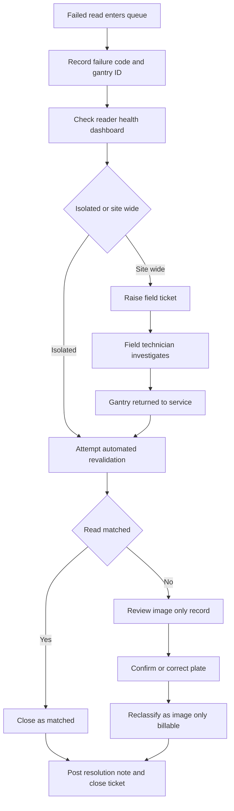

# SOP: Investigating a Failed Toll Tag Read

- ***Scenario:*** Operations procedure for triaging a failed tag read on an all-electronic
tolling gantry. Fictional company, Cascade Mobility.
- ***Audience:*** Traffic management center operators and revenue assurance analysts.
- ***Demonstrates:*** Procedure writing, process mapping, structured authoring, exception
handling, and version control.

---

## Purpose

Define the standard sequence for triaging, resolving, and closing a failed tag read so
that valid revenue is captured, hardware faults are identified quickly, and no
transaction is billed twice.

## Scope

Applies to all all-electronic tolling gantry sites and to reads that fail validation and
produce an image only transaction.

Excludes payment disputes, account adjustments, and out of state plate lookups, which
follow their own procedures.

## Roles

| Role | Responsibility |
|---|---|
| TMC Operator, Tier 1 | Triage, failure code capture, duplicate suppression |
| Revenue Assurance Analyst, Tier 2 | Revalidation, image review, reclassification |
| Field Technician | Reader and camera hardware diagnosis and repair |
| Operations Supervisor | Escalation, billing suspension, write off approval |

## Prerequisites

- Transaction Management System access with the Analyst role
- Reader Health dashboard access
- Current shift handover log reviewed
- Ticket opened in the operations queue

## Process

**Text equivalent:** A failed read triggers failure code capture and a reader health
check. The path then branches on whether the fault is isolated or site wide. Isolated
faults go to automated revalidation and, if that fails, to image review and
reclassification. Site wide faults go to a field ticket and return to revalidation once
the gantry is back in service. Both paths close with a resolution note.

## Procedure

Tier 1 target: triage within 30 minutes. Tier 2 target: resolution within 4 hours.

1. Open the Failed Read queue and filter to the last 24 hours. 
   **Expected result:** The queue lists transactions with status FAILED_VALIDATION.
2. Record the failure code and the gantry ID on the ticket. 
   **Expected result:** Both values are captured and the ticket is time stamped.
3. Check the Reader Health dashboard for that gantry. 
   **Expected result:** Reader status and last successful read time are displayed.
4. Determine whether the failure is isolated or site wide. 
   **Expected result:** The ticket is classified as ISOLATED or SITE_WIDE.
5. For an isolated failure, run automated revalidation. 
   **Expected result:** Validation re runs and the status becomes MATCHED or remains
   FAILED_VALIDATION.
6. For a site wide failure, raise a field ticket with the gantry ID and time window. 
   **Expected result:** The ticket is assigned to a Field Technician and the gantry is
   flagged as degraded.
7. If revalidation fails, open the image only record. 
   **Expected result:** The plate image, confidence score, and lane are displayed.
8. Confirm or correct the plate read against the image. 
   **Expected result:** The transaction is reclassified as IMAGE_ONLY_BILLABLE.
9. Post a resolution note using the standard resolution code. 
   **Expected result:** The ticket status is CLOSED with a resolution code attached.
10. Carry any unresolved items into the shift handover log. 
    **Expected result:** Open items appear in the handover log with current status and
    owner.

## Exceptions and Troubleshooting

| Condition | Likely Cause | Action | Owner |
|---|---|---|---|
| READ_NO_MATCH | Tag absent from the database | Attempt image billing, then route unreadable plates to manual review | Tier 2 |
| LOW_CONFIDENCE | Reader misalignment or weather | Verify reader health, raise a field ticket if recurring | Tier 2 |
| DUPLICATE | Two reads inside the deduplication window | Suppress the later read, bill once | Tier 1 |
| Reader offline | Power or network fault | Raise a field ticket, mark the gantry degraded | Field Technician |
| Site wide failure above 5 percent | Calibration drift or interference | Escalate to Supervisor, consider suspending billing | Supervisor |
| Image unreadable | Camera fault or glare | Route to manual review, do not auto write off | Tier 2 |

## Revision History

| Version | Date | Change | Author |
|---|---|---|---|
| 1.1 | October 19, 2026 | Added site wide threshold and escalation path | K. Vollweiler |
| 1.0 | September 2026 | Initial release | K. Vollweiler |

## Related Documents

- [Style guide excerpt](style-guide-excerpt.md)
- [Requirements and acceptance criteria](requirements-and-acceptance-criteria.md)
- [FAT Verification Procedure](fat-verification-procedure.md)
